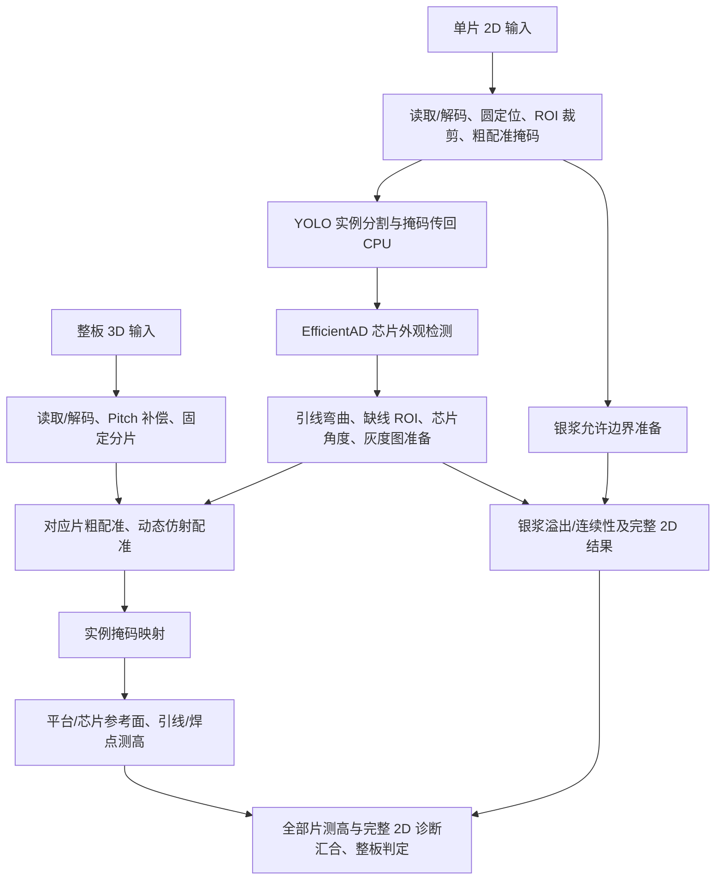

# 检测流程、并行机会与数学优化分析

分析日期：2026-11-06。范围为当前工作区 Python 服务、配置、现有测试和保存的检测记录；本次只新增分析资料，未修改检测实现或生产配置。

## 1. 结论与证据范围

项目已经有按片推进的并发流水线，以及独立的实例级任务池。下一步最值得投入的是**动态仿射配准的评分计算、整板 Pitch 补偿，以及解除 YOLO 之后对 EfficientAD 的等待**。

读取了最近 6 次保存的、请求成功且明确标记模型复用的 10 片联合检测记录，共 60 片。记录时间为 2026-11-06 12:28–12:32；客户端整板耗时 4.446–5.184 秒，中位数 4.618 秒。服务端从收到 3D 请求到完成的耗时中位数为 3.976 秒。这两个时间的起止点不同，不能互相替代。样本包含不同板号，属于现有运行观察，并非固定输入、固定线程配置的受控对照。

| 阶段 | 60 片平均耗时 | 说明 |
| --- | ---: | --- |
| 联合 3D 总阶段 | 2464.9 ms/片 | 多片重叠执行 |
| 动态仿射配准 | 1938.2 ms/片 | 占联合阶段累计耗时约 78.6% |
| 实例掩码映射 | 105.6 ms/片 | 已使用实例池 |
| 测高总阶段 | 376.5 ms/片 | 包括参考面、引线、焊点，存在子阶段重叠 |
| GPU 工作阶段 | 578.6 ms/片 | 包括 CPU 准备、数据传输、YOLO、EfficientAD 等 |
| 银浆连续性 | 339.6 ms/片 | 已有局部统计与 bincount 优化 |
| 银浆溢出测量 | 139.6 ms/片 | 当前矩形边界已有距离快速计算 |
| 2D 返回轮廓生成 | 102.1 ms/片 | 存在重复提取的机会 |
| 2D 图片解码 | 255.0 ms/片 | 此批记录使用编码图片输入 |
| 整板 Pitch 补偿 | 728.4 ms/板 | 6 次平均，是联合 3D 启动前的依赖 |

这些是并发负载下的墙钟阶段时间，包含运行时等待及调度影响。嵌套阶段不能相加，10 片的时间也不能直接相加作为整板耗时，更不能把 78.6% 当作整板加速比例。

原始路径、各阶段统计、请求 ID 过滤后的并发峰值、变换实验结果保存在 [evidence.json](D:/projects/247-likai/visualization/output/detection-analysis-20261106/evidence.json)。可用 [collect_evidence.py](D:/projects/247-likai/visualization/output/detection-analysis-20261106/collect_evidence.py) 重新提取；脚本会选择运行时最新的 6 份符合条件的记录。

## 2. 当前检测流程

正式入口是 [bridge_server.py](D:/projects/247-likai/python/transport/bridge_server.py)。带板号和片号的 2D 请求、带板号的整板 3D 请求交给 [board_pipeline.py](D:/projects/247-likai/python/algorithm/board_pipeline.py)；具体算法集中在 [detect_board.py](D:/projects/247-likai/python/algorithm/detect_board.py)。

1. **初始化**：合并 2D/3D 配置，加载 YOLO、两类 EfficientAD 模型，为 GPU 工作槽建立独立资源和可用时的 CUDA stream，创建各阶段任务池。
2. **2D 输入准备**：原始 BGR 共享内存可使用视图；编码输入需要读取和解码。按圆定位构造检测 ROI、引线 ROI，并生成粗配准使用的缩放平台掩码。
3. **2D 两支并行**：银浆边界准备与 GPU 分支同时提交。目前银浆为 `roi_inset`，由 ROI 四边内缩生成矩形，跳过模板 SIFT。GPU 分支内部仍按 YOLO → 掩码提取 → 逐芯片 EfficientAD 顺序执行。
4. **几何结果准备**：GPU 分支结束后，计算引线弯曲、缺线 ROI 和芯片旋转；发布联合 3D 所需输入。
5. **完整 2D 后处理**：几何结果及边界就绪后执行银浆溢出、连续性检查，生成完整单片响应。
6. **3D 深度准备**：整板深度读取后先做 SmartRay Pitch 补偿，再按配置的 10 个固定区域确定分片。测量时按分片行范围取全宽深度视图。
7. **联合 3D**：某片几何输入和对应深度片一旦就绪，即可开始粗配准 → 六参数动态仿射 → 掩码映射 → 参考面拟合 → 测高。无需等待该片银浆诊断完成，也无需等其他片完整 2D 完成。
8. **最终汇合**：10 片完整 2D 与联合 3D 均完成后，合并各检查状态并返回整板结果。协议 `ok=true` 表示请求成功；产品合格看检测结果中的 `is_ok`。

服务通过完成回调衔接阶段，避免工作线程空等尚未到达的另一类输入。旧请求没有 `request_id` 时仍维持按序应答，会限制客户端请求重叠。单次整板同步接口也不等于以上流式调度路径。

工作区有 `Bridge.sln`、`Bridge.dll`，但其引用的 `src/` 源码目录不存在，因此本次未验证 C# 采集端是否同时提交请求、是否提前提交 3D、是否正确携带请求 ID。

## 3. 已经实现的并行与当前资源配置

当前磁盘配置：

| 任务池 | 工作槽 | 配置来源 |
| --- | ---: | --- |
| 输入准备/几何准备/深度准备 | 15 | `common_3d.threading.cpu_workers` |
| GPU | 15 | `common_2d.threading.gpu_workers` |
| 银浆边界 | 15 | `common_2d.threading.silver_workers` |
| 完整 2D 后处理 | 15 | `common_2d.threading.postprocess_workers` |
| 联合 3D | 15 | `common_3d.threading.joint_workers` |
| 实例叶子任务 | 20 | `common_3d.threading.instance_workers` |

前五池共 75 个槽，满足配置的 `worker_budget=80`。实例池单独创建，当前不计入该预算，所以实际配置上限为 **95 个工作槽**；线程按任务需要创建，并非一直有 95 个线程同时运行。`early_joint_workers` 未配置，代码默认等于 `joint_workers=15`。

本机读到 i9-14900KF、24 核/32 逻辑处理器、RTX 4080 16 GB。只处理一块 10 片板时，单个按片阶段最多需要同时处理 10 片，15 个 GPU 模型槽无法进一步提高该板的片级并发上限；跨板重叠时资源需求不同。模型副本会增加内存/显存占用，不能由线程数推断加速。

README 中的 5/3/5/5/5 配置和历史 30 秒级测试不是当前配置和当前记录，不能直接用来判断本机瓶颈。现有结果未保存完整生效线程配置快照，因此也不能把当前磁盘配置无条件追溯为这 6 次记录的初始化配置。

对最近一次结果按全部 11 个精确请求 ID 过滤日志，得到：

| 软件任务区间 | 峰值重叠数量 |
| --- | ---: |
| 2D 输入准备 | 10 |
| GPU 工作阶段 | 10 |
| 2D 后处理 | 9 |
| 联合 3D | 10 |
| 动态仿射 | 10 |
| 实例焊点任务 | 20 |

GPU 阶段区间重叠只证明调用与任务生命周期重叠；不能证明 10 个 CUDA kernel 同时执行。6 次记录中 GPU、2D 后处理、联合 3D 的平均队列等待分别约 0.171、0.196、0.254 ms，明显小于其执行时间。因此优先减少计算与依赖等待，再做工作槽对照试验。

## 4. 还可以怎样并行

| 机会 | 当前顺序与可调整关系 | 优先级与边界 |
| --- | --- | --- |
| YOLO 完成后提前发布几何输入 | 当前 EfficientAD 完成后才提交几何；可让几何/3D 配准与 EfficientAD 同时进行 | **高**。几何和配准主要依赖分割结果；需把外观诊断留到最终汇合，并解决实例字典被两支写入的问题。不能直接让现有函数共享可变对象并行运行 |
| 参考面任务与引线测高 | 当前先拟合平台、逐芯片拟合参考面，再处理引线 | 中。平台面和不同芯片面在只读输入准备后可独立计算；平台面完成即可启动引线测量，无需等待全部芯片面 |
| 引线与焊点 | 当前引线任务全部返回后才提交焊点 | 中。细线分段和必要参考面准备好后，可统一提交独立叶子任务；不能让实例池中的任务再向同池提交并同步等待 |
| 同片银浆溢出与连续性 | 当前 `inspect_masks` 内串行执行 | 中。共享只读类别并集后可分支，但当前已有多片后处理重叠，新增任务可能只增加竞争，须测整板收益 |
| 同类芯片 EfficientAD 批量推理 | 当前每片内按芯片逐一推理 | 中。按模型、输入尺寸分组组成小批；影响批等待、异常图评分和响应结构，需要逐芯片对照 |
| ROI 定位与粗配准平台掩码 | 当前输入准备按顺序完成后才启动 GPU | 低至中。平台掩码可独立准备，ROI 就绪后即送推理；注意原图所有读者结束前不能释放共享内存 |
| Pitch 分块处理 | 当前整板每 256 行顺序投影 | 条件性。目标像素可能跨块且发生碰撞，应使用独立输出加 max 归并，或先明确无冲突分区，不能无保护地写同一输出 |

现有跨片并行、银浆边界分支、提前联合 3D、实例映射/测高并行已落地，应保留而无需重新设计。

## 5. 数学计算优化与简化

### 5.1 动态仿射配准：首要热点

位置：[registration.py:138](D:/projects/247-likai/python/algorithm/registration.py:138)。当前 Powell 优化六个参数，每次评分都执行一次完整目标画布的最近邻仿射变换，然后只在若干区域统计二值失配。

目标函数为：

\[
L(p)=\frac{1}{K}\sum_{k=1}^{K}\frac{\#\{W_p(S)_k\ne T_k\}}{|R_k|}
+\lambda\left((p_2/s)^2+(p_3/s)^2\right).
\]

每个区域等权，不能改成全体像素混合后的一个平均，否则大小不同的区域权重会改变。二值失配计数已经代替 int16 差值图，不应重复做这项优化。

建议按以下顺序试验：

1. **补充实际评分次数**：记录 `nfev`、评分调用次数、warp 与失配统计耗时。保存结果里只有迭代次数；最近样本可见 5 次 Powell 迭代，但一次迭代会多次评分。直接把 `maxiter=35` 调小不一定减少这些样本的工作。
2. **缓存完全相同参数的标量评分**：缓存键为精确参数元组，限定单片、单次优化生命周期；前后诊断只需要 loss 时无需再次生成图像。避免用参数量化近似合并相邻评分。
3. **只生成评分区并集的外接框**：可减少无用目标像素，但必须验证取整一致性。本次用一张真实阈值图及 10 个保存矩阵进行微实验，目标 778×1511，评分外接框面积占全图 71.73%；9 个矩阵完全一致，1 个矩阵出现 1 像素差异。最近邻栅格化的数值细节可能改变离散目标及搜索路径，因此这项只能列为待验证候选。
4. **减少求解工作量的算法改造**：多尺度粗到细、前板结果作为候选初值、分阶段优化平移/尺度/剪切。此类可能改变收敛结果，须保留当前配准为失败回退，并以配准误差和最终高度判定验证。不能跨板直接复用变换矩阵。

微实验中整图/局部 warp 单次中位数为 0.751/0.465 ms，仅是单线程 10 次调用的局部测量；不能据此预告配准或整板加速比例。

### 5.2 Pitch：预计算深度值查找表

位置：[tilt_correction.py:111](D:/projects/247-likai/python/algorithm/tilt_correction.py:111)。当前开启 15°、按行补偿，整板补偿先于分片，平均约 728 ms/板。

恢复方向的当前公式为：

\[
z=(d-o)s+z_0,\qquad r'=\operatorname{rint}(r-z\tan\beta/p),
\qquad d'=\operatorname{rint}((z/\cos\beta-z_0)/s+o).
\]

其中原始深度为 uint16，只有 65536 种取值。参数不变时，可按**原公式及相同运算顺序**预计算每个深度值的未取整行偏移、补偿深度及有效标志；逐像素只做查表、最终坐标取整和带碰撞的最大深度归并。表随角度、步距、Z 分辨率、偏移、原点或方向变化而失效。

关键边界：保留 `rint(r+shift[d])`，不能随意换成 `r+rint(shift[d])`，半整数的舍入可能不同；目标像素碰撞仍必须保留 max 语义。查表能减少算术，但 `np.maximum.at` 的散射写入可能仍占主要成本，收益需要单独测量。

也不能先按原始行号切成 10 片后独立补偿，因为补偿会让像素跨过原片边界。

### 5.3 仿射矩阵走仿射映射，并复用公共映射

位置：[registration.py:391](D:/projects/247-likai/python/algorithm/registration.py:391)。主路径生成的齐次矩阵末行为 `[0,0,1]`，但实例映射统一使用 `warpPerspective`。

数学上该分母恒为 1，可在确认矩阵为仿射时用 `warpAffine`；实际透视矩阵继续走原路径。进一步可每片预计算公共逆映射，供多个实例复用，减少重复坐标求逆与计算。

本次微实验的 10 个矩阵在同一张二值图上，两个 API 的结果均无差异，但时间接近（0.751 与 0.775 ms/次）。这不足以证明任意掩码都逐像素相同，也不足以保证明显收益。完整图像 remap 的坐标图内存成本和缓存带宽也应计入。

### 5.4 细线主轴：N×2 SVD 改为 2×2 特征分解

位置：[height_measurement.py:238](D:/projects/247-likai/python/algorithm/height_measurement.py:238)。现实现对所有前景坐标中心化后进行 SVD，主要用到第一条主轴。

可累计中心化二阶矩：

\[
C=\begin{bmatrix}\sum \Delta x^2&\sum \Delta x\Delta y\\
\sum \Delta x\Delta y&\sum \Delta y^2\end{bmatrix},
\quad v=\operatorname{eigvec}_{\max}(C),
\quad t_i=\Delta x_i v_x+\Delta y_i v_y.
\]

这样求解只涉及一个 2×2 对称矩阵，并可避免 Nx2 左奇异向量等中间分配。两种方式整体仍需线性扫描 N 个点，不应宣称从立方复杂度降为常数复杂度。

主轴符号不唯一，直接替换可能交换 `start/end`、测量编号和焊点身份；两个特征值接近时主轴也不稳定。需要固定方向约定、对退化形状保留旧路径，并逐像素比较两端分段。属于数值等价候选，不能直接当作无行为变化的替换。

### 5.5 鲁棒平面拟合：稳定后提前结束

位置：[height_measurement.py:404](D:/projects/247-likai/python/algorithm/height_measurement.py:404)。目前最多连续做 5 次最小二乘及 MAD 筛点，即使内点集合已经不变也继续计算。

若一轮重新得到的 `keep_new` 与本轮求解使用的 `keep` 完全相同，后续输入矩阵和深度值不变，可以提前结束。保持相同的点顺序、筛选阈值和返回字段，是较低风险的优化方向。

不要直接用未归一化的正规方程替代 `lstsq`：这会改变数值条件。也不要把少算几轮、改变采样步长或减少候选点直接称为等价优化。参考面的小变化会传导到毫米级测高和阈值边缘。

### 5.6 每片共享只读中间结果

| 重复工作 | 建议 | 注意事项 |
| --- | --- | --- |
| `platform_mask_2d` 转灰度，之后 `_prepared_gray_image` 再转一次 | 输入准备时生成灰度并复用 | 保持“先灰度后缩放”和“先阈值后缩放”两条现有处理顺序；它们不可互换 |
| 银浆溢出和连续性各自生成 silver 并集 | 依据类别集合和形状生成共享只读并集 | 配置允许两个功能指定不同类名，不能无条件共用同一掩码 |
| 相同 2D 掩码多次提取轮廓/包围框 | 缓存几何原语或按 offset、epsilon 缓存结果 | 2D 返回用 epsilon=1，联合掩码用 epsilon=2，不能直接共用已简化轮廓 |
| 多个参考面重复判断深度有效性 | 每片生成有效像素图并按 ROI 切片复用 | 保留配置的 `invalid_values`，不要只支持当前的 0/65535 |
| 每个芯片重新遍历其他实例生成排除并集 | 多芯片场景可累计未膨胀掩码覆盖次数，减去当前芯片后再按原规则膨胀 | 保留重叠语义；只有少量芯片时，覆盖计数的额外内存与计算未必更快 |

### 5.7 高度差的代数简化与不可偷换的量

当前先算 `h=(d-o)s`、`h_ref=(ax+by+c-o)s`，再相减。可化为：

\[
\Delta h=(d-(ax+by+c))s.
\]

零点偏移抵消，公式更直接，能减少部分相消误差；这是每个测量点的少量标量运算，性能收益很小。浮点运算顺序改变时仍应检查阈值边缘结果。

当前测高先从原始深度的 95 分位附近选一个实际像素，再在该坐标求参考平面差。它不等于“对所有像素的平面高度差取 95 分位”，平面倾斜时会选不同位置；不能以简化为由替换。也要保留相同距离候选的选点顺序和无效值处理。

## 6. 推荐实施顺序与验证标准

1. **建立可重复基线**：固定输入、保存配置和依赖版本、模型复用后多次运行；同时记录客户端整板耗时、配准评分次数、队列等待和显存峰值。当前虚拟环境实际读到 Torch 2.11.0+cu128，而项目声明为 2.7.1，复现实验时应保存实际环境。
2. **先减少无用工作**：重复灰度转换、可复用几何和类别并集、平面内点稳定后的提前停止、完全相同配准参数的评分缓存。
3. **重点评估关键路径**：Pitch 查表，YOLO 后提前几何/3D，配准评分范围缩小。评分范围优化已有取整差异，必须先通过完整结果回归再考虑采用。
4. **最后调整数值方法和并发规模**：2×2 主轴、公共映射、GPU 小批、跨任务重排。GPU 工作槽可对照 1/2/4/8/10，联合和实例池分别调节，保留最小整板耗时且结果达标的组合；这些只是试验取值，不是已验证的最佳配置。

验证应比较最终 OK/NG、配准有效性与矩阵/误差、掩码和缺陷面积、主轴分段身份、测高坐标和毫米值；离散边界与阈值附近样本需单独覆盖。数学等价只作为候选依据，最终以结果对照为准。当前代码已有局部形态学、轮廓包围框、银浆扇区聚合、矩形边界距离、GPU 掩码批量传回、实例级并行等优化，不列作新增收益。

本次执行已有 Python 测试：`python -B -m unittest discover -s tests -p 'test_*.py'`，**165 项通过**。没有重新加载全套 GPU 模型运行新整板基准，也没有把局部实验当作完整优化后的生产成绩。
